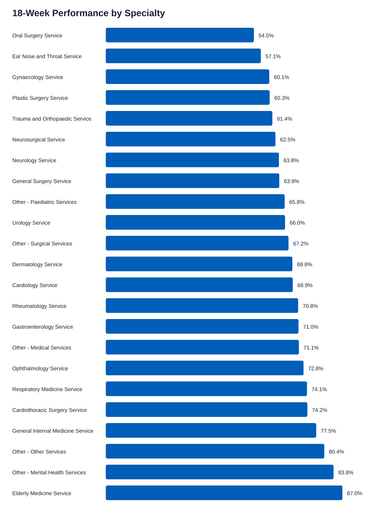

# NHS RTT Waiting Times Analytics

Healthcare Data Analyst portfolio project using NHS England consultant-led Referral to Treatment (RTT) waiting times as the intended public data source. The project analyses elective care backlog, 18-week performance, long-waiters, specialty pressure, trust variation, and operational improvement opportunities.

Intended public source: [NHS England Consultant-led Referral to Treatment Waiting Times](https://www.england.nhs.uk/statistics/statistical-work-areas/rtt-waiting-times/)

## Business Problem

NHS operational teams need clear visibility of waiting list pressure, 18-week target performance, long-waiting patients, and specialty-level bottlenecks. This project converts RTT-style data into dashboard-ready KPIs and recommendations for capacity planning and performance recovery.

## Executive Summary

This project answers six healthcare analytics questions:

- Which trusts have the largest waiting list pressure?
- Which specialties have the weakest 18-week performance?
- Where are long-waiters concentrated?
- Which regions show the greatest recovery risk?
- How is total backlog changing month by month?
- Which operational actions should be prioritised?

## Key Results

| KPI | Value |
| --- | ---: |
| Total Waiting List | 1,212,046 |
| 18-Week Performance | 72.8% |
| Patients Waiting 52+ Weeks | 18,413 |
| Highest Pressure Specialty | Trauma and Orthopaedics |
| Trusts Below 60% 18-Week Performance | 0 |
| Long-Waiter Share | 1.5% |

In the demo output, Trauma and Orthopaedics has the weakest 18-week performance and the highest long-waiter share. Regionally, the North West and North East and Yorkshire show the largest long-waiter shares, giving an immediate focus for elective recovery monitoring.

## Dashboard Preview




## Repository Structure

```text
data/
  raw/
    nhs_rtt_demo.csv
  processed/
    rtt_waiting_list_assessed.csv
    specialty_summary.csv
    trust_pressure_summary.csv
    region_summary.csv
    monthly_trend_summary.csv
    executive_kpi_summary.csv
dashboard/
  screenshots/
docs/
  nhs_data_source_instructions.md
  data_dictionary.md
  dashboard_requirements.md
  operational_recommendations.md
  portfolio_scorecard.md
sql/
  nhs_rtt_analysis_queries.sql
src/
  generate_demo_data.py
  build_nhs_rtt_analysis.py
```

## Tools Used

- Python: pandas and numpy
- SQL: waiting list KPIs, specialty performance, trust pressure, regional variation, trend reporting
- Dashboarding: Power BI/Tableau-ready outputs and SVG previews
- Business analysis: KPI definitions, operational recommendations, stakeholder-ready summary

## How To Run

Option 1: Use official NHS England RTT data.

1. Download consultant-led RTT CSV/XLSX files from NHS England.
2. Transform or save them into the expected raw structure described in `docs/nhs_data_source_instructions.md`.
3. Run:

```powershell
python src/build_nhs_rtt_analysis.py
```

Option 2: Run immediately with demo data.

```powershell
python src/generate_demo_data.py
python src/build_nhs_rtt_analysis.py
```

## Data Privacy

The intended NHS source is public aggregate statistics. The demo data generated in this repo is synthetic and does not contain patient-level or personally identifiable data.

## Suggested GitHub Topics

`nhs`, `healthcare-analytics`, `data-analysis`, `sql`, `python`, `power-bi`, `dashboard`, `public-health`, `business-intelligence`
