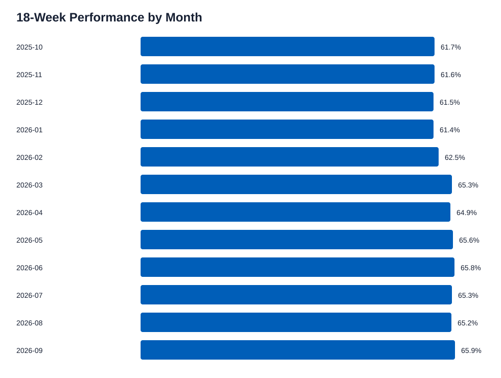
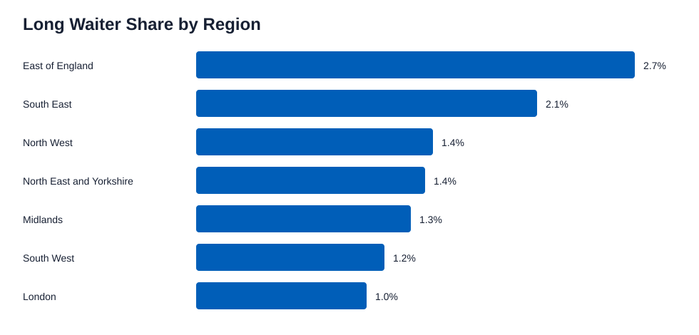

# NHS RTT Waiting Times Analytics

Analysis of NHS England's published consultant-led Referral to Treatment (RTT) waiting times: size of the elective waiting list, performance against the 18-week standard, waits over 52 weeks, and how these vary by specialty, provider and region.

Source: [NHS England Consultant-led Referral to Treatment Waiting Times](https://www.england.nhs.uk/statistics/statistical-work-areas/rtt-waiting-times/), monthly "Full CSV data file" extracts.

**Months covered:** October 2025 to September 2026 (12 monthly files, downloaded 16 November 2026).

Every figure below is produced by the code in this repository from those files. Nothing is synthetic.

## Questions

- How large is the waiting list and how is it changing month by month?
- Which specialties are furthest from the 18-week standard?
- Where are waits over 52 weeks concentrated?
- How do regions and providers differ?

## Results: September 2026

| Measure | Value |
| --- | ---: |
| Incomplete pathways (waiting list) | 7,074,324 |
| Within 18 weeks | 65.9% |
| Waiting over 52 weeks | 110,546 (1.6%) |
| Estimated median wait | 12.2 weeks |
| Providers reporting | 526 |
| Providers below 60% within 18 weeks | 52 |
| Providers with 10,000+ pathways | 129 |
| ...of which below 60% within 18 weeks | 14 |

The operational standard is 92% within 18 weeks. No region and no specialty meets it.

**Specialty.** Oral Surgery has the lowest 18-week performance (54.5%), followed by Ear Nose and Throat (57.1%) and Gynaecology (60.1%). Trauma and Orthopaedics is the largest list (830,089 pathways, 61.4% within 18 weeks). Plastic Surgery has the highest share waiting over 52 weeks (3.6%).

**Region.** East of England has both the lowest 18-week performance (61.5%) and the highest share over 52 weeks (2.7%). North East and Yorkshire has the highest 18-week performance (69.2%). London has the lowest share over 52 weeks (1.0%).

**Provider.** Among providers with at least 10,000 pathways, Mid and South Essex NHS Foundation Trust stands out: 161,994 pathways, 51.6% within 18 weeks, 8.1% over 52 weeks. The provider ranking in `trust_pressure_summary.csv` is not filtered by size, so its top rows are small independent providers with a few hundred pathways. Read it alongside `total_waiting_list`.

**Trend.**

| Month | Waiting list | Within 18 weeks | Over 52 weeks |
| --- | ---: | ---: | ---: |
| 2025-10 | 7,304,189 | 61.7% | 170,759 |
| 2025-11 | 7,159,010 | 61.6% | 154,121 |
| 2025-12 | 7,199,624 | 61.5% | 138,711 |
| 2026-01 | 7,155,958 | 61.4% | 133,860 |
| 2026-02 | 7,124,952 | 62.5% | 120,871 |
| 2026-03 | 7,014,835 | 65.3% | 92,607 |
| 2026-04 | 7,093,502 | 64.9% | 97,388 |
| 2026-05 | 7,153,655 | 65.6% | 102,341 |
| 2026-06 | 7,147,562 | 65.8% | 103,318 |
| 2026-07 | 7,131,685 | 65.3% | 108,263 |
| 2026-08 | 7,158,164 | 65.2% | 109,936 |
| 2026-09 | 7,074,324 | 65.9% | 110,546 |

18-week performance rose 4.2 percentage points over the year. Waits over 52 weeks fell to 92,607 in March 2026 and have risen in each of the six months since.

The fall in the reported waiting list (229,865 fewer pathways than October 2025) is mostly a reporting effect, not a real reduction. See the first limitation below.






## Reconciliation against published figures

`src/download_nhs_rtt_data.py` compares the transformed data with NHS England's own "RTT Overview Timeseries" workbook (September 2026 edition). Full table: `data/processed/national_reconciliation.csv`.

| Month | Waiting list, this repo | Waiting list, published | Difference | Within 18 weeks, this repo | Published | Median estimate, this repo | Published |
| --- | ---: | ---: | ---: | ---: | ---: | ---: | ---: |
| 2025-10 | 7,304,189 | 7,304,189 | 0 | 61.70% | 61.70% | 13.31 | 13.31 |
| 2025-11 | 7,159,010 | 7,159,010 | 0 | 61.64% | 61.64% | 12.90 | 12.90 |
| 2025-12 | 7,199,624 | 7,199,624 | 0 | 61.45% | 61.45% | 13.45 | 13.45 |
| 2026-01 | 7,155,958 | 7,155,958 | 0 | 61.43% | 61.43% | 13.62 | 13.62 |
| 2026-02 | 7,124,952 | 7,124,952 | 0 | 62.54% | 62.54% | 13.17 | 13.17 |
| 2026-03 | 7,014,835 | 7,014,835 | 0 | 65.29% | 65.29% | 11.33 | 11.33 |
| 2026-04 | 7,093,502 | 7,093,502 | 0 | 64.95% | 64.95% | 11.90 | 11.90 |
| 2026-05 | 7,153,655 | 7,153,655 | 0 | 65.56% | 65.56% | 12.42 | 12.42 |
| 2026-06 | 7,147,562 | 7,147,562 | 0 | 65.83% | 65.83% | 11.87 | 11.87 |
| 2026-07 | 7,131,685 | 7,131,685 | 0 | 65.30% | 65.30% | 11.97 | 11.97 |
| 2026-08 | 7,158,164 | 7,158,164 | 0 | 65.21% | 65.21% | 12.21 | 12.21 |
| 2026-09 | 7,074,324 | 7,074,324 | 0 | 65.90% | 65.90% | 12.18 | 12.18 |

Waiting list total, pathways within 18 weeks, pathways over 52 weeks and the median all match the published series for all 12 months.

The match depends on one choice: the published headline is on a commissioner basis and counts English commissioners only, so pathways commissioned outside England (code `NONC`, 30,641 in September 2026) are excluded. With them included, the provider-basis total for September 2026 would be 7,104,965.

## Method

1. **Download.** Links to the monthly zips are scraped from the NHS England yearly pages (the URLs contain upload dates and cannot be guessed).
2. **Filter.** Incomplete pathways only (`Part_2`). The pre-summed `Total` treatment function rows are dropped and totals rebuilt from the individual treatment functions.
3. **Aggregate.** The file has one row per provider, commissioner and treatment function, with 105 weekly wait bands. Bands are summed across commissioners, then grouped: 0 to 18 weeks, over 18 to 52 weeks, over 52 weeks.
4. **Median.** Estimated from the weekly band counts by finding the band that holds the middle pathway and interpolating linearly inside it. It is an estimate, not a patient-level median.
5. **Region.** The file gives each provider's parent Integrated Care Board, not an NHS region. Each ICB code (48 across the 12 months, because ICBs merged during the period) is looked up in the official NHS ODS API and mapped to its NHS England region. The result is saved in `data/reference/icb_region_lookup.csv`. All 48 mapped; none were assigned by hand.
6. **Pressure bands.** High if 18-week performance is below 60% or the share over 52 weeks is 4% or more; Medium if below 70% or 2.5% or more. In September 2026: 55 providers High, 135 Medium, 336 Lower.

## Limitations

- **Missing providers.** Not every trust submits every month. NHS England publishes a second total that includes estimates for missing trusts: 7,375,866 for September 2026, which is 301,542 more than the reported 7,074,324. In October 2025 the gap was 91,256. On the estimated basis the list fell by only 19,579 over the year, not 229,865. This repo uses reported data only, so month-to-month and regional comparisons are affected by who submitted.
- **Region is the provider's parent ICB region.** It is where the provider sits, not where patients live. Independent sector providers are placed under the ICB that NHS England lists as their parent.
- **Provider counts include independent sector providers**, many with very small lists. The "below 60%" count of 52 falls to 14 when limited to providers with 10,000+ pathways.
- **`avg_median_wait_weeks` in the summary tables is an unweighted mean of row-level median estimates**, not a pooled median. Use the national figure in `national_reconciliation.csv` for the headline median.
- **Pressure band thresholds are this project's own**, chosen to split providers into groups. They are not an NHS definition.
- **Snapshot of revisable data.** NHS England revises past months. Figures here reflect the files available on 16 November 2026.
- **Aggregate counts only.** The data counts pathways, not unique patients, and says nothing about clinical priority or reasons for delay.

## Repository structure

```text
src/
  download_nhs_rtt_data.py     download, filter, aggregate, region lookup, reconciliation
  build_nhs_rtt_analysis.py    KPIs, summary tables, SVG charts
  generate_demo_data.py        synthetic offline fallback only
tests/
  test_download_nhs_rtt_data.py
sql/
  nhs_rtt_analysis_queries.sql
data/
  raw/                         downloads and reshaped extract (not in git)
  reference/icb_region_lookup.csv
  processed/                   national_reconciliation, executive, monthly, specialty, region, provider tables
dashboard/screenshots/         SVG charts
docs/
```

## How to run

```powershell
pip install -r requirements.txt
python src/download_nhs_rtt_data.py
python src/build_nhs_rtt_analysis.py
python -m pytest
```

The download step needs internet access (about 42 MB from NHS England, plus the ODS API). Running it later will pick up the latest 12 months, so figures will differ from those above.

Without internet access, `python src/generate_demo_data.py` creates a synthetic file so the pipeline can still be exercised. The build script prints a warning when it uses it. That data is random and none of the figures in this README come from it.

## Tests

`tests/test_download_nhs_rtt_data.py` covers the weekly band aggregation (summing across commissioners, the 18-week and 52-week boundaries, the three groups adding up to the total), the 18-week performance calculation and the median estimate.

## Data and licence

NHS England RTT statistics are public aggregate data published under the Open Government Licence v3.0. No patient-level data is used.
